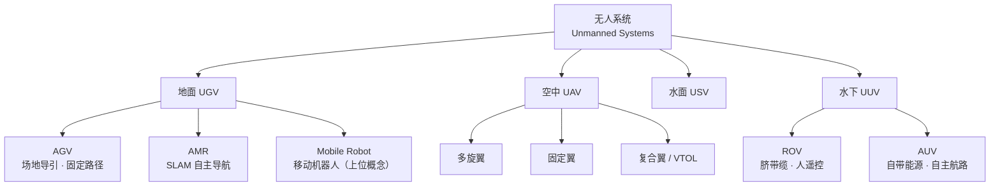

### 一句话速记

- **UGV**：在地上跑的无人车，军用／特种语境最常用
- **UAV**：天上飞的无人机
- **UUV**：水下航行的无人潜器
- **AGV**：按固定路线自动跑的搬运车
- **AMR**：能自己认路、自己避障的移动机器人

### 快速对照表

| 缩写 | 英文全称 | 中文常用译名 | 核心特征 | 典型场景 |
| --- | --- | --- | --- | --- |
| UGV | Unmanned Ground Vehicle | 地面无人车／无人地面平台 | 地面自主或遥控行驶，轮式／履带／足式 | 军用侦察排爆、农业、矿区、园区巡检 |
| UAV | Unmanned Aerial Vehicle | 无人机 | 空中飞行，多旋翼／固定翼／复合翼 | 航拍测绘、植保、巡检、物流 |
| UUV | Unmanned Underwater Vehicle | 无人水下航行器／无人潜器 | 水下自主或缆控航行 | 海底测绘、管线检测、军事侦察 |
| AGV | Automated Guided Vehicle | 自动导引车／自动导引运输车 | 依赖磁条、二维码、反光板等场地导引，路径预设 | 仓储搬运、产线物料配送 |
| AMR | Autonomous Mobile Robot | 自主移动机器人 | SLAM 建图定位、实时规划、动态避障，无需改造场地 | 仓储拣选、柔性产线、服务机器人 |
| USV | Unmanned Surface Vehicle | 无人艇／无人水面航行器 | 水面自主航行 | 水文测量、水域巡逻、UUV 母船 |
| ROV | Remotely Operated Vehicle | 缆控水下机器人 | 脐带缆供电与通信，人工实时遥控 | 深海作业、打捞、水下检修 |
| AUV | Autonomous Underwater Vehicle | 自主水下航行器 | 自带能源、预编程航路、自主作业 | 大范围海底测绘、水下搜索 |
| MR | Mobile Robot | 移动机器人 | 能自主移动的机器人上位概念，涵盖 AGV／AMR／UGV 等 | 学术表述、通用分类 |

### UGV：地面无人车

全称 Unmanned Ground Vehicle，直译"无人地面车辆"。注意它强调的是**平台本身是无人驾驶的地面载具**，至于上面装什么（相机、雷达、机械臂、喷施装置）属于载荷，不影响它叫 UGV。

行进方式与适用地形：

| 形式 | 优点 | 局限 | 典型地形 |
| --- | --- | --- | --- |
| 轮式 | 效率高、结构简单、能耗低 | 越野差、越障弱 | 平整路面、园区、大棚走道 |
| 履带 | 接地比压小、爬坡越障强 | 速度慢、转弯磨损大 | 松软土、果园行间、矿区 |
| 足式 | 离散落点，可跨台阶碎石 | 控制难、成本高、效率低 | 废墟、山地、楼梯 |

控制方式分三档：**遥控遥操作**（人全程操作）、**半自主**（人给目标点，机器自己走）、**全自主**（建图＋定位＋路径规划＋避障全自动）。

UGV 这个词最早出自军事与特种作业（排爆、侦察、物资前送），后来才外溢到农业、矿区、园区安防。所以果园里的轮式喷施底盘、划线小车，从分类上都属于 UGV＋作业机构的组合。

### AGV：自动导引车

全称 Automated Guided Vehicle，也译"自动导引运输车"。关键词是 **Guided（被导引）**——它靠场地里预先布置的参照物来确定自己在哪，而不是靠自己感知并理解环境。

常见导引方式：

| 导引方式 | 原理 | 特点 |
| --- | --- | --- |
| 磁条／磁钉 | 地面埋磁条，车底磁传感器循迹 | 抗干扰强，但改线要重新施工 |
| 二维码 | 地面贴码，车顶相机读码定位 | 精度高、成本低，场地要铺满码 |
| 反光板＋激光 | 激光雷达扫反光板做三角定位 | 精度高，需要布设反光柱 |
| 轨道／有线 | 早期电磁或物理导轨 | 已基本淘汰 |

核心特征：**路径基本预设，改路线就得改场地**（贴码、埋线、重标定地图）。换来的是成本低、稳定、重复定位精度高，特别适合高节拍、固定流程的仓储和产线。

### AMR：自主移动机器人

全称 Autonomous Mobile Robot。关键词是 **Autonomous（自主）**——靠自身传感器（激光雷达、深度相机、IMU、轮式里程计）完成建图与定位（SLAM），自己规划路径、自己绕开突然出现的人或货。

核心特征：

- 无需改造场地，不贴码不埋线，到场扫一圈地图就能跑，部署周期从周级降到小时级
- 支持动态避障、多机调度、路径实时重规划
- 对算力和算法要求高，单机成本高于 AGV

典型算法栈可以拆成四层：**SLAM 建图定位 → 全局路径规划（A*／Dijkstra）→ 局部避障（DWA／TEB）→ 运动控制（PID／Stanley）**。这条链路和 ROS 2 里的 nav2 结构基本对应。

### UGV、AGV、AMR 三者的关系

一句话：**UGV 是"地面无人平台"的宽口径说法，AGV 和 AMR 是工业物流场景下的两个具体流派，分水岭在于"靠场地导引"还是"靠自己感知"。**

| 对比维度 | UGV | AGV | AMR |
| --- | --- | --- | --- |
| 概念定位 | 宽泛平台概念 | 工业物流设备 | 工业／服务机器人 |
| 定位方式 | 组合导航（GNSS／SLAM／遥控） | 场地导引（磁／码／反光板） | 自身 SLAM |
| 是否改造场地 | 一般不要求 | 必须 | 不要求 |
| 路径灵活性 | 高 | 低，改线成本高 | 高，实时重规划 |
| 动态避障 | 视配置 | 基本没有 | 有 |
| 成本 | 跨度大 | 低 | 中高 |
| 常见语境 | 军用、农业、特种 | 仓库、产线 | 仓库、柔性产线、商用服务 |

### UAV：无人机

全称 Unmanned Aerial Vehicle，直译"无人驾驶航空器"。按气动布局分三类：

| 布局 | 优点 | 局限 | 用途 |
| --- | --- | --- | --- |
| 多旋翼 | 可悬停、起降简单、操控直观 | 续航短、载荷小 | 航拍、植保、巡检 |
| 固定翼 | 续航长、覆盖广、效率高 | 不能悬停、起降需跑道或弹射 | 测绘、大面积巡查 |
| 复合翼／VTOL | 垂直起降＋巡航长续航 | 结构复杂、成本高 | 长航时测绘、物流 |

配套术语：飞控（Flight Controller）、图传、RTK 差分定位、航线规划、FPV（第一人称视角飞行）、BVLOS（超视距飞行）。

### UUV：水下无人潜器

全称 Unmanned Underwater Vehicle，中文多用"无人潜器"或"无人水下航行器"。它是水下无人系统的总称，往下再分 ROV 和 AUV 两条技术路线。

UUV 与 UAV／UGV 最大的技术差异是**通信与定位**：水下电磁波衰减极快，GPS 和无线电基本失效，所以只能靠：

- 惯性导航（INS）＋ 多普勒计程仪（DVL）做航位推算
- 声呐（侧扫、多波束、前视）感知与成像
- 水声通信（速率低、延迟大、距离有限）
- 预编程航路，浮出水面再回传数据

这也是为什么水下机器人普遍"自主性更高、实时遥控更难"。

### ROV 与 AUV：UUV 的两条路线

| 对比项 | ROV（缆控） | AUV（自主） |
| --- | --- | --- |
| 全称 | Remotely Operated Vehicle | Autonomous Underwater Vehicle |
| 供电与通信 | 脐带缆，电力与信号不断 | 自带电池，出水面后回收数据 |
| 操作方式 | 操作员实时遥控 | 预编程航路＋自主决策 |
| 作业时长 | 长（母船持续供电） | 受电池限制，数小时到数十小时 |
| 机动范围 | 受缆长限制 | 覆盖范围大 |
| 优势 | 精细作业、可实时干预 | 大范围测绘、成本低、不受缆约束 |
| 典型任务 | 深海取样、打捞、平台检修 | 海底地形测绘、搜救、水雷探测 |

此外还有 **ARV（混合型）**，兼顾缆控精细作业与无缆自主巡航。

### USV：无人艇（顺带补充）

全称 Unmanned Surface Vehicle，水面无人航行器。常作为 UUV 的"母船"：USV 开到目标海域，释放并回收 AUV，从而把水下作业半径放大。这样 UGV／USV／UUV 就构成空地水一体的无人系统组合。

### 概念关系图

### 容易混用的几个点

- **UGV ≠ AGV**：军用说 UGV，仓库说 AGV；前者强调无人平台，后者强调被导引的搬运车
- **AGV ≠ AMR**：能不能不改场地自己跑起来，是这两者的分水岭
- **无人机 ≠ 航模**：是否有自主飞控与任务规划能力，是区分门槛
- **UUV 包含 ROV 和 AUV**：ROV 有缆、AUV 无缆，别把 ROV 说成"潜水器"就完事
- **"移动机器人"是上位概念**：Mobile Robot 涵盖 AGV／AMR／UGV，写论文时用它做统称不会错

### 英文简写字母序总表（主词）

把正文出现的核心缩写按字母排一遍，方便反向查。

| 缩写 | 英文全称 | 中文 | 所属域 |
| --- | --- | --- | --- |
| AGV | Automated Guided Vehicle | 自动导引车 | 地面 |
| AMR | Autonomous Mobile Robot | 自主移动机器人 | 地面 |
| AUV | Autonomous Underwater Vehicle | 自主水下航行器 | 水下 |
| MR | Mobile Robot | 移动机器人 | 通用 |
| ROV | Remotely Operated Vehicle | 缆控水下机器人 | 水下 |
| UAV | Unmanned Aerial Vehicle | 无人机 | 空中 |
| UGV | Unmanned Ground Vehicle | 地面无人车 | 地面 |
| USV | Unmanned Surface Vehicle | 无人艇 | 水面 |
| UUV | Unmanned Underwater Vehicle | 无人水下潜器 | 水下 |

### 延伸缩写：无人系统通用与任务层

这一层不指向某台设备，而是指"系统"或"任务"，写论文和看规范时最容易和上面那批混。

| 缩写 | 英文全称 | 中文 | 说明 |
| --- | --- | --- | --- |
| UxV | Unmanned Vehicle（x 代表 G／A／S／U 任一场域） | 无人系统统称 | 泛指 UAV／UGV／USV／UUV 全家族的写法 |
| UAS | Unmanned Aircraft System | 无人航空器系统 | 含飞行器＋地面站＋数据链＋操作员，比 UAV 完整 |
| RPAS | Remotely Piloted Aircraft System | 遥控驾驶航空器系统 | ICAO 官方用语，适航与空域管理文书用这个 |
| RPA | Remotely Piloted Aircraft | 遥控驾驶航空器 | RPAS 里"机"的那一部分 |
| sUAS | small Unmanned Aircraft System | 小型无人航空器系统 | 美 FAA 口径，指 55 磅（约 25 kg）以下 |
| DAA | Detect and Avoid | 探测与规避 | 航空避让；地面机器人惯用 SAA（Sense and Avoid） |
| C-UAS | Counter-Unmanned Aircraft System | 反无人机系统 | 探测、干扰、拦截一整套反制 |
| ISR | Intelligence, Surveillance and Reconnaissance | 情报、监视与侦察 | 军用无人系统的核心任务链 |
| UTM | UAS Traffic Management | 无人机交通管理 | 低空空域协同管理 |
| BVLOS | Beyond Visual Line of Sight | 超视距飞行 | 与 VLOS（目视范围内）相对 |
| FPV | First-Person View | 第一人称视角 | 穿越机、沉浸式遥控 |

### 延伸缩写：地面车辆家族

AGV 只是物流地面机器人里的一支，实际项目里还会撞上一串近义缩写。

| 缩写 | 英文全称 | 中文 | 区分要点 |
| --- | --- | --- | --- |
| UGVS | Unmanned Ground Vehicle System | 地面无人车系统 | 系统级说法，车＋遥控站＋链路 |
| UGCV | Unmanned Ground Combat Vehicle | 无人地面战斗车辆 | 军用战斗型 |
| AGC | Automated Guided Cart | 自动导引小车 | 轻载、牵引式，日系厂商常用，本质是简化版 AGV |
| LGV | Laser Guided Vehicle | 激光导引车 | 按导引介质命名的 AGV 分支 |
| IGV | Intelligent Guided Vehicle | 智能导引车 | AGV 加一点自主，介于 AGV 与 AMR 之间 |
| AIV | Autonomous Intelligent Vehicle | 自主智能车 | 物流行业说法，常见于料箱／货到人系统 |
| ATV | All-Terrain Vehicle | 全地形车 | 泛指越野载具，不一定无人 |
| AS/RS | Automated Storage and Retrieval System | 自动化立体仓库 | 和 AGV／AMR 配套的存取系统 |

### 延伸缩写：空中家族

| 缩写 | 英文全称 | 中文 | 区分要点 |
| --- | --- | --- | --- |
| MAV | Micro Air Vehicle | 微型飞行器 | 厘米级、扑翼或多旋翼微型平台 |
| VTOL | Vertical Take-Off and Landing | 垂直起降 | 不经跑道的起降能力 |
| eVTOL | electric Vertical Take-Off and Landing | 电动垂直起降 | 载人空中出租车那一类 |
| UCAV | Unmanned Combat Aerial Vehicle | 无人作战飞机 | 军用攻击型，与民用 UAV 分开说 |
| UAM | Urban Air Mobility | 城市空中交通 | 城市低空载人／载货体系 |

### 延伸缩写：水面与水下家族

| 缩写 | 英文全称 | 中文 | 区分要点 |
| --- | --- | --- | --- |
| ASV | Autonomous Surface Vehicle | 自主水面航行器 | 与 USV 近义，更强调自主性 |
| ARV | Autonomous and Remotely-operated Vehicle | 自主／遥控混合型水下机器人 | 兼顾缆控精细作业与无缆巡航 |
| AUG | Autonomous Underwater Glider | 水下滑翔机 | 靠浮力调节滑翔，能耗极低、续航数月 |
| HOV | Human Occupied Vehicle | 载人潜水器 | 蛟龙号属这一类，不是无人系统 |
| DSV | Deep Submergence Vehicle | 深潜器 | 强调大深度作业能力 |

### 延伸缩写：水下导航定位

UUV 没有 GPS，这套声学与惯性组合的缩写最好一起记。

| 缩写 | 英文全称 | 中文 | 作用 |
| --- | --- | --- | --- |
| INS | Inertial Navigation System | 惯性导航系统 | 不依赖外部信号，误差随时间累积 |
| DVL | Doppler Velocity Log | 多普勒计程仪 | 测对底速度，抑制 INS 漂移 |
| AHRS | Attitude and Heading Reference System | 姿态航向参考系统 | 提供姿态与航向 |
| USBL | Ultra-Short BaseLine | 超短基线定位 | 船载声学阵列，精度高、作用距离短 |
| SBL | Short BaseLine | 短基线定位 | 介于超短与长基线之间 |
| LBL | Long BaseLine | 长基线定位 | 海底布阵，覆盖大、布设慢 |

### 延伸缩写：机器人本体类型

这些不都是缩写，多数就是英文单词，但论文里高频出现。

| 术语 | 中文 | 说明 |
| --- | --- | --- |
| Manipulator／Robotic Arm | 机械臂 | 固定基座为主，工业机器人主流形态 |
| Industrial Robot | 工业机器人 | 按 ISO 8373 定义，含焊接、搬运、装配等 |
| Cobot（Collaborative Robot） | 协作机器人 | 可与人共享工作空间，有力感知与安全限速 |
| Humanoid | 人形机器人 | 双足＋双臂＋头部形态 |
| Quadruped | 四足机器人 | 四足步态，机器狗那类 |
| Exoskeleton | 外骨骼机器人 | 穿戴式助力／康复 |
| Soft Robot | 软体机器人 | 柔性材料驱动，适应性强、负载小 |
| Swarm Robotics | 集群机器人 | 多机自组织协同，与单机智能相对 |
| Service Robot | 服务机器人 | 非工业场景下的作业机器人 |
| Teleoperation | 遥操作 | 人机远程操控，不是设备名而是作业方式 |

### 延伸缩写：移动机器人技术栈

在 ROS 2 项目里天天见的一批，顺手一起归档。

| 缩写 | 英文全称 | 中文 |
| --- | --- | --- |
| ROS／ROS 2 | Robot Operating System | 机器人操作系统（实为中间件框架） |
| SLAM | Simultaneous Localization and Mapping | 同步定位与建图 |
| VSLAM | Visual SLAM | 视觉 SLAM |
| LiDAR | Light Detection and Ranging | 激光雷达 |
| ToF | Time of Flight | 飞行时间测距 |
| IMU | Inertial Measurement Unit | 惯性测量单元 |
| GNSS | Global Navigation Satellite System | 全球导航卫星系统 |
| RTK | Real-Time Kinematic | 实时动态差分定位 |
| UWB | Ultra-Wideband | 超宽带定位／测距 |
| EKF | Extended Kalman Filter | 扩展卡尔曼滤波 |
| MPC | Model Predictive Control | 模型预测控制 |
| DWA | Dynamic Window Approach | 动态窗口法（局部避障） |
| TEB | Timed Elastic Band | 时间弹性带（局部规划） |
| Nav2 | Navigation2 | ROS 2 官方导航栈 |
| PID | Proportional-Integral-Derivative | 比例－积分－微分控制 |
| BMS | Battery Management System | 电池管理系统 |
| SOC | State of Charge | 电池荷电状态 |

### 缩写用词提醒

- **UAV／UAS／RPAS 别混着用**：说"那架飞机"用 UAV；说"整套系统（机＋地面站＋链路）"用 UAS；写适航、空域、民航监管文书用 RPAS
- **AGV 的 G 是 Guided**：标准写法是 Automated Guided Vehicle（ANSI/ITSDF B56.5），写成 Automatic Guided Vehicle 也能见到，但规范表述用 Automated
- **UUV 是总称**：ROV／AUV 是它的两个子类，不能并列成三种设备
- **"潜器"与"潜水器"有别**：无人叫潜器（UUV），载人叫潜水器（HOV／DSV）
- **USV 与 ASV 近义**：偏向"无人"说 USV，偏向"自主"说 ASV，同一台设备两种叫法都成立
- **drone 是口语词**：正式论文、报告里写 UAV／UAS，不用 drone
- **UxV 属概览写法**：适合综述开头一句"无人系统（UxV）"，不适合当具体设备的正式名称
- **Robot 与 Unmanned System 不重合**：无人系统强调"无人驾驶"，机器人强调"可编程作业"，一台 UGV 装上机械臂就同时是两个概念
