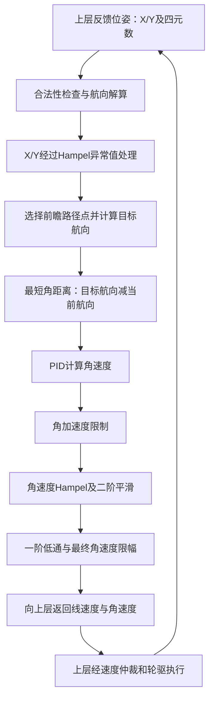

### 直线跟随控制器与参数配置：纠偏机制详解

核对日期：2026年10月12日。本文依据以下远程文件的只读检查，未修改车辆代码、未驱动车辆。

| 文件                                                                                                                             | 作用                          |
| ------------------------------------------------------------------------------------------------------------------------------ | --------------------------- |
| `/home/qingz/xline_ws4/xline_ws3/src/xline_base_controller/xline_follow_controller/src/line_follow/line_follow_controller.cpp` | 位姿处理、直线制导、PID转向、状态切换、喷印质量检测 |
| `/home/qingz/xline_ws4/xline_ws3/src/xline_base_controller/xline_follow_controller/config/line.yaml`                           | 配置PID、速度、前瞻、滤波、进线和喷印阈值      |

配套基础算法说明：[[02_follow_common.hpp_详解]]。

#### 1. 纠偏不是修改传感器坐标

本控制器根据反馈位姿改变车辆运动方向，让车辆回到目标直线；不会修改全站仪X/Y，不直接订阅IMU，也不在这里进行定位融合或IMU标定。

`computeVelocityCommands()`接收上层传入的位姿，校验坐标和四元数，归一化四元数，通过 `tf2::getYaw()` 得到航向。位姿是否精准，仍取决于上层定位、航向校准、坐标系与机械参数。



#### 2. 当前启用的是前瞻航向制导

当前配置 `guidance.mode: weighted_yaw`。核心函数是 `handlePathFollowing()`，不是直接调用RPP直线跟随函数。

正向行驶时，前瞻航向计算为：

```text
前瞻航向 = atan2(前瞻点Y - 车辆Y, 前瞻点X - 车辆X)
理想直线航向 = 路径起始姿态中的航向
```

代码在单位圆上进行加权，避免在正负180°附近直接平均角度出现错误：

```text
加权X = 理想航向权重 × cos(理想航向) + 前瞻航向权重 × cos(前瞻航向)
加权Y = 理想航向权重 × sin(理想航向) + 前瞻航向权重 × sin(前瞻航向)
目标航向 = atan2(加权Y, 加权X)
```

| 配置                       | 对齐阶段 | 跟随阶段 | 实际含义                   |
| ------------------------ | ---: | ---: | ---------------------- |
| `current_heading_weight` |  0.0 |  0.0 | 加权的是理想直线航向，并非当前测得的车头航向 |
| `target_heading_weight`  |  1.0 |  1.0 | 加权的是车辆指向前瞻点的航向         |

因此当前目标航向完全由前瞻点方向决定。假设目标直线沿X正向，车在直线左侧，前瞻点位于其右前方，控制器向右修正；回到直线上后，前瞻航向接近直线方向。

`distance.lookahead: 0.25` 是前瞻点选择的距离阈值，不能简单理解为每次一定恰好取车辆前方25cm处的点；还取决于路径点分布与 `getNextWaypoint()` 的选点规则。

#### 3. 横向误差的几何含义

代码找到最近路径段，用单位切向与左法向计算横向误差：

```text
单位切向 u = (线段终点 - 线段起点) / 线段长度
左法向 n = (-u_y, u_x)
横向误差 e = (车辆位置 - 线段起点) · n
```

正向情况下，正误差表示车辆在路径左侧，负误差表示在右侧。后退模式会翻转路径切向及法向，并调整目标车头方向，最后将线速度取负。

当前weighted_yaw分支通过“指向前瞻点”间接回线；显式横向误差还用于进线判断、喷印门控和严重偏差检测。

#### 4. Stanley和混合模式是备用方案

```text
回线偏角 = atan2(-k × 横向误差, |线速度| + v0)
目标航向 = 路径切向航向 + 限幅后的回线偏角
```

| 参数 | 当前值 | 作用及是否生效 |
|---|---:|---|
| `guidance.mode` | weighted_yaw | 当前生效的制导模式 |
| `guidance.stanley_k` | 1.0 | Stanley回线增益，当前分支不使用 |
| `guidance.stanley_v0` | 0.1m/s | Stanley低速软化项，当前分支不使用 |
| `guidance.theta_max` | 0.25rad，约14.32° | Stanley截获角上限，不限制当前weighted_yaw分支 |
| `guidance.alignment_mode` | stanley | 仅mode为hybrid时用于进线 |
| `guidance.following_mode` | weighted_yaw | 仅mode为hybrid时用于跟随 |

负号使回线偏角与横向误差方向相反，避免越纠越偏。切换模式属于调参，需要实测验证，不能仅凭公式断言新模式一定更精准。

#### 5. 航向误差如何变成角速度

```text
航向误差 = shortest_angular_distance(当前航向, 目标航向)
PID输出 ≈ Kp×误差 + Ki×误差积分 + Kd×误差变化率
```

`computeAngularVelocity()`依次执行PID输出限幅、角加速度限制、Hampel异常值处理、二阶平滑、一阶低通、最终角速度限幅。具体PID积分和微分离散细节以 `follow_common.hpp` 当前实现为准。

| 参数 | 当前值 | 说明 |
|---|---:|---|
| `heading_pid.alignment.kp/ki/kd` | 1.0 / 0.0 / 0.1 | 进线PID |
| `heading_pid.following.kp/ki/kd` | 1.0 / 0.0 / 0.1 | 跟随PID；当前没有积分纠偏 |
| `phase.alignment.max_angular_vel` | 0.08rad/s | 进线转向限幅 |
| `phase.following.max_angular_vel` | 0.065rad/s | 稳定跟随转向限幅 |
| `phase.alignment.max_angular_accel` | 0.07rad/s² | 进线转向变化限制 |
| `phase.following.max_angular_accel` | 0.05rad/s² | 跟随转向变化限制 |
| `phase.alignment.filter_alpha` | 0.8 | 本次平滑结果权重 |
| `phase.following.filter_alpha` | 0.95 | 本次平滑结果权重 |
| `phase.*.smoother_freq` | 15.0 | 二阶平滑器配置值；具体单位转换以平滑器实现为准 |
| `phase.*.smoother_damping` | 0.86 | 二阶平滑阻尼配置 |

一阶低通的实际公式：

```text
本次输出 = alpha × 本次平滑值 + (1-alpha) × 上次输出
```

所以alpha越大越信任本次值，并不是alpha越大旧值占比越大。角速度加速度限制、二阶平滑与低通会共同影响响应，不能孤立调整其中一项。

#### 6. 位置滤波和角速度滤波不要混淆

| 环节 | 配置 | 当前用途 |
|---|---|---|
| X/Y Hampel | 窗口5，k=3.0 | 实时控制使用其输出 |
| X/Y SG | 窗口7，多项式阶数3 | 仅用于调试记录，不用于实时纠偏 |
| 角速度Hampel | 窗口5，k=3.0 | 处理PID及加速度限制之后的角速度 |
| 二阶平滑及低通 | phase分阶段配置 | 平滑转向输出 |

不能把调试中的SG平滑轨迹当成实时控制坐标，也不能把滤波后的漂亮轨迹当作地面实际墨线精度。

#### 7. 起步与稳定进线条件

状态机先经过 `ALIGNING_START` 原地航向对齐，再进入 `FOLLOWING_PATH`。路径跟随过程中，`updateStartLineAlignment()`仍要求位置和航向同时满足条件。

| 条件 | 配置 | 当前值 |
|---|---|---:|
| 距直线的横向误差 | `phase.alignment.line_cross_track_tolerance` | ≤0.003m，即3mm |
| 相对直线的航向误差 | `phase.alignment.line_heading_tolerance` | ≤0.02rad，约1.15° |
| 连续合格次数 | `phase.alignment.line_alignment_stable_count` | 10次 |

任一不满足，连续次数清零。达标后设置 `start_line_aligned_=true`，切换跟随PID和平滑参数，重置相关历史状态。10次对应多少时间取决于实际调用频率，不能仅凭该参数给出固定秒数。

车头对齐不等于已经回到直线中间；原地转向只能改变航向，横向偏移要通过行进中的回线纠偏消除。

#### 8. 线速度与纠偏能力的关系

| 配置 | 当前值 | 含义 |
|---|---:|---|
| `velocity.accel_min` | 0.05m/s | 加速阶段最小速度配置 |
| `velocity.decel_min` | 0.03m/s | 减速阶段最小速度配置 |
| `velocity.alignment` | 0.05m/s | 对齐/进线速度配置 |
| `velocity.walk_max` | 5.0m/s | 配置上限，不代表实际执行速度或硬件安全能力 |
| `velocity.work_max` | 5.0m/s | 配置上限，不代表实际执行速度或硬件安全能力 |
| `distance.acceleration` | 0.15m | 加速距离配置 |
| `distance.deceleration` | 0.25m | 减速距离配置 |
| `distance.alignment` | 0.08m | 对齐距离配置 |
| `distance.waypoint_tolerance` | 0.01m | 路径点容差配置，不等同于最终划线精度 |

线速度由 `computeLinearSpeed()`计算，结合运行时覆盖、路径长度与阶段进行处理，不是始终使用YAML上限。速度越高，在同样0.065rad/s转向限制下可实现的曲率越小；还要考虑传感器延迟、角加速度限制和轮驱响应。

#### 9. 喷墨门控与故障判断

喷印需要同时满足：已稳定进线、在planner指定喷区内、横向与航向误差均合格、不是转场路径。

| 配置 | 当前值 | 行为 |
|---|---:|---|
| `print.max_cross_track_error` | 0.005m，即5mm | 超过则停喷 |
| `print.max_heading_error` | 0.03rad，约1.72° | 超过则停喷 |
| `print.abort_cross_track_error` | 0.03m，即30mm | 喷区内严重误差判断 |
| `print.abort_heading_error` | 0.20rad，约11.46° | 喷区内严重误差判断 |
| `print.abort_stable_count` | 3次 | 严重误差连续超限后故障 |
| `print.max_unprinted_distance` | 0.01m，即10mm | 累计不合格覆盖超限则失败 |
| `print.start_distance/stop_distance` | 0.14m / 0.03m | 旧配置兼容；实际喷区按planner显式区间 |

代码按直线投影进度累计合格/不合格喷区距离，避免停喷后走完全程仍返回成功。这里的 `printed_distance_`是质量条件推算的覆盖距离，不是喷墨机反馈或地面视觉测得的真实墨线长度。

因此“5mm喷印阈值”不能证明实际划线已达到5mm，更不能证明毫米级精度。喷头TF偏移、延时、墨路状态、定位误差和轮胎打滑都需要独立验证。

#### 10. 终点与进度处理

每个控制周期将车辆位置投影到原始直线，单调更新 `path_progress_`，用于进展看门狗、喷区统计及终点保护。该进度是沿直线的投影，不是累积实际走过的曲折路程。

满足终点条件后输出零速度，等待再进入完成状态；喷区覆盖不足会返回失败。如果沿直线投影超过终点且超出 `max(0.02m, 2×waypoint_tolerance)`仍未达到要求，返回故障。当前该越过量阈值计算为0.02m。

源码中的 `ALIGNING_END`名称不能据此解释为一定执行一次额外精密航向旋转：本次查看分支主要关闭喷印并设置到达状态；终点具体合格判据还应结合 `isBeyondGoal()`及相关安全函数阅读。

#### 11. 为什么有纠偏仍会走歪

| 原因 | 应核对证据 | 不应直接下的结论 |
|---|---|---|
| 上层航向有偏差 | 直线方向与robot_pose航向、校准结果 | 不一定是PID太小 |
| 位置延迟或跳变 | 位姿时间戳、全站仪更新周期、Hampel输出 | 滤波越多不一定越准确 |
| 转向能力不足 | 角速度是否长期达到0.065rad/s限制 | 提高线速度不一定改善回线 |
| 轮驱左右响应不同 | 目标速度、反馈轮速及实测轨迹 | 不能靠改TF掩盖底盘偏差 |
| 前瞻与速度不匹配 | 横向误差、目标航向及纠偏振荡 | 改小前瞻不一定更稳定 |
| 软件配置未生效 | 安装目录配置、节点实例、运行时覆盖 | 修改src文件不等于已部署 |
| 喷头位置/延时错误 | 喷头TF、喷墨开关时刻、地面墨线 | 车体走直不等于墨线正确 |

建议先核对位姿及底盘方向，再检查低速跟随的误差和饱和情况，最后逐项调制导/PID/限幅。每次只改变一个参数组，并保留前后对比，不能通过放宽喷印阈值来冒充精度提升。

#### 12. 修改参数后如何确认真正生效

`updateParameters()`通过 `ament_index_cpp::get_package_share_directory("xline_follow_controller")`读取安装目录下的 `config/line.yaml`，不是固定直接读取src目录文件。构造时加载配置；本次未验证是否存在外部运行时重载入口。

1. 确认启动终端source的是 `/home/qingz/xline_ws4/xline_ws3/install/setup.bash`，没有旧工作空间覆盖。
2. 查看 `ros2 pkg prefix --share xline_follow_controller`指向哪个安装目录。
3. 比较源目录与安装目录的 `config/line.yaml`；symlink安装可能链接源文件，但普通安装可能是副本。
4. 修改源码/YAML后按项目方式构建对应包，确认构建成功。
5. 在安全静止且没有任务执行时重建控制器实例或重启相关节点；不能只保存文件就假定旧实例已刷新。
6. 核对上层任务是否通过运行时速度设置覆盖YAML值。
7. 通过日志和低速对比试验验证响应变化，记录误差，而不是只确认进程在线。

以上是部署与验证原则，不表示本次执行了编译、重启、改参或实车测试。
