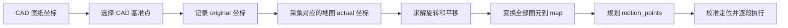
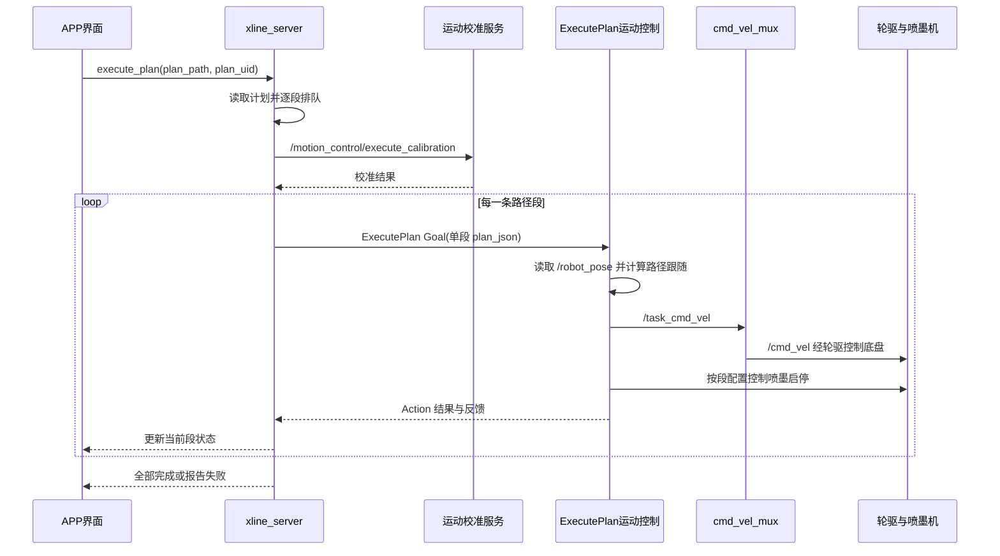

### X-LINE APP 划线流程与基准点配准说明

#### 文档目的

本文把围绕 X-LINE CAD 划线流程的讨论整理为一份可操作的说明，重点解释：

- APP 从 CAD 图纸到小车实际划线，完整经过哪些环节；
- 选择 CAD 基准点后，APP 当前代码实际保存和改变了什么；
- 基准点如何与全站仪地图坐标配对，才能把图纸正确放到现场；
- 定位校准、路径规划、ExecutePlan、速度仲裁和喷墨分别承担什么职责；
- 如何区分源项目设计、移植项目实现和一次具体图纸的状态。

本文依据本机源项目 `E:\aaa_program\xline\X-LINE-Source_code` 的实现与说明整理。运行端项目为 `/home/qingz/xline_ws4/xline_ws3`。两套代码存在移植和版本差异，现场执行前应以运行端的实际构建版本和日志为准，不能仅凭本机源码推断设备当前行为。

#### 先看结论

“在 CAD 图上选中一个或多个基准点”不等于“图纸已经配准到全站仪地图”。源项目的 CAD 界面能够记录和显示 CAD 基准点，并将 CAD 坐标写入 JSON；默认情况下，基准点的 `actual` 仍为空，坐标变换矩阵仍为 `null`。在没有实际地图坐标、变换矩阵和可执行路径点时，图纸坐标不能直接用于驱动车辆。



#### 系统中的几种坐标不能混为一谈

| 坐标或数据 | 常见单位 | 表示内容 | 主要来源 |
|---|---:|---|---|
| CAD `original` | DXF 单位，常见为毫米 | 图纸自身的几何坐标 | DXF 文件和 CAD 解析器 |
| 全站仪棱镜坐标 | 米 | 棱镜在当前测量坐标系中的位置 | `/reflector_position` |
| 车体位置 `/robot_pose` | 米 | 定位融合后车体基准点在地图中的位置及姿态 | 全站仪、安装偏移、IMU 和定位节点 |
| 已配准图纸坐标 | 米或项目约定单位 | 转换到现场地图后的图纸点 | CAD 到地图的变换 |
| `motion_points` | 控制器约定；当前控制器路径数据通常为毫米后换米 | 路径规划最终给控制器跟随的点列 | 路径规划器 |

全站仪报告棱镜的位置，而不是天然报告喷头、轮轴中点或车体基座的位置。定位节点会按棱镜安装偏移和航向计算车体基准点。CAD 到地图的配准则是另一件独立工作：它决定整张图纸在现场的位置和朝向。

#### APP 划线的端到端顺序

| 顺序 | 环节 | 主要输入 | 主要输出或检查点 |
|---:|---|---|---|
| 1 | 启动 ROS 运行环境和所需节点 | ROS 工作空间、设备配置 | 全站仪、定位、IMU、规划器、运动控制、轮驱、仲裁器和喷墨节点在线 |
| 2 | 初始化全站仪 | LN150 驱动服务 | 仪器连接成功 |
| 3 | 自动调平 | 仪器状态 | 调平服务返回成功且仪器没有错误 |
| 4 | 瞄准并自动跟踪棱镜 | 棱镜处在仪器视野内 | `/reflector_position` 连续更新 |
| 5 | 检查定位输入 | 棱镜坐标、`/imu` | 时间戳新鲜、坐标有效、IMU 姿态持续更新 |
| 6 | 导入 CAD 图纸 | DXF 和单位信息 | CAD 图元、图层、单位解析正确 |
| 7 | 选线和选基准点 | 要绘制的图元、CAD 特征点 | 线条选择状态和 `base_points.points[*].original` |
| 8 | 将 CAD 点与现场测量点配对 | CAD `original` 点、地图 `actual` 点 | 足够且分布合理的对应点，包含残差检查 |
| 9 | 计算并应用 CAD 到地图变换 | 配对点、坐标系和单位 | 图纸的地图坐标、变换矩阵及配准精度 |
| 10 | 路径规划 | 已配准图纸、喷墨和车体参数、车辆起始位置 | 有序工作路径、转场路径和权威 `motion_points` |
| 11 | 执行前检查 | 定位、速度链路、驱动、打印机和任务状态 | 状态有效、任务独占、空闲速度为零、端点符合预期 |
| 12 | 姿态/定位校准 | 全站仪轨迹和 IMU | 校准结果有效，`/robot_pose` 更新连续 |
| 13 | 逐段发送 ExecutePlan | 单条规划路径和唯一任务 ID | 每段接收、反馈、成功或明确失败 |
| 14 | 速度跟随和喷墨同步 | 当前位姿、路径点和喷墨设置 | 跟随控制器发布速度，喷头按路径区间开关 |
| 15 | 完成和记录 | Action 结果、传感器和设备状态 | 停车、任务状态更新、日志保留 |

启用真实设备时，应区分“姿态校准”和“CAD 图纸配准”：前者建立定位航向和传感器关系，后者把图纸摆放到场地地图里。两者都需要，彼此不能替代。

#### 选择基准点之后，APP 当前实际做了什么

源项目的 CAD 视图在基准点选择模式下，允许用户点击线段端点、非闭合多段线顶点及部分非闭合曲线端点。点击时，程序先把鼠标位置转换为 CAD 场景坐标，再按当前缩放比例计算搜索容差，在容差范围内选择最近的候选端点；过近的重复点会被忽略。成功后画布绘制带编号的圆形标记，点保存在视图的 `base_points` 列表中。用户可以撤销最近一次选点；重新打开导出的 JSON 时，程序可从 `original` 坐标恢复这些标记。

源码：`E:\aaa_program\xline\X-LINE-Source_code\xline_cad\src\ui\graphics_view.py`，重点查看 `_pick_line_endpoint_near()`、`_extract_line_endpoints()`、`_add_base_point()` 和 `_rebuild_base_point_markers()`。

保存图纸时，`main_window.py` 从 `graphics_view.base_points` 收集二维点，交给 `FileService` 导出。`file_service.py` 的 `_prepare_base_points_export()` 将它们写入 `base_points.points`；新点默认结构包括：

源码：`E:\aaa_program\xline\X-LINE-Source_code\xline_cad\src\ui\main_window.py` 第 1326 行附近；`E:\aaa_program\xline\X-LINE-Source_code\xline_cad\src\services\file_service.py` 第 1534 行附近。

| 字段 | 当前默认含义 |
|---|---|
| `id`、`name` | 基准点编号和显示名称 |
| `original.x/y` | 点在 CAD 图纸坐标系中的坐标 |
| `actual` | 现场实际坐标；默认是 `null` |
| `is_control_point` | 是否作为控制点的标记 |
| `is_required` | 默认前两个点标记为必需 |
| `role`、`priority`、`weight` | 角色、优先级和权重等预留信息 |
| `status` | 默认 `pending` |

文件级别的默认结构是：

```json
{
  "coordinate_system": "original",
  "transformation_type": null,
  "transformation_matrix": null,
  "transformation_parameters": null,
  "accuracy_tolerance": 0.001,
  "points": []
}
```

所以，基准点选择后当前确定发生的变化是：CAD 点被记录、显示并能随文件保存；如果 `actual` 仍为空且 `transformation_matrix` 仍为 `null`，图形的所有坐标并没有因此自动移动、旋转或转换到全站仪地图坐标。

##### “选完基准点”到底完成了什么

| 阶段 | 已完成的任务 | 形成的成果 | 还不能做什么 |
|---|---|---|---|
| 点击 CAD 基准点后 | 确定图纸中哪些点将作为现场对照点 | 画布标记和内存中的 CAD 坐标 | 不能确定这些点在现场哪里 |
| 保存图纸 JSON 后 | 将点编号与 `original.x/y` 写入文件 | 可重复读取的 `base_points.points` | 不能得到 `actual`、旋转角或平移量 |
| 现场配对后 | 为各 CAD 点填入实测地图坐标 | `original ↔ actual` 对应表 | 尚需求解和验证变换 |
| 配准计算并验证后 | 将整张图纸定位到同一现场地图坐标系 | 变换参数、变换后的图元和残差报告 | 仍需生成控制器可执行路径 |

选点阶段的目的，是在图纸上建立稳定、可复查的“锚点”。例如把图纸的一个角标为 1 号点，另一个相距较远的角标为 2 号点。之后，现场人员要找到它们对应的物理位置并测量地图坐标。选点结束并不代表车辆已经知道图纸的位置，也不改变 `/robot_pose`。

若图纸的角点在现场还没有可识别的实体位置，就无法直接“测出对应点”。需要先由施工基准、已有标记或测量放样确定这些位置；不能把棱镜当前所在位置随意配给某个 CAD 点。

#### 从 CAD 基准点到全站仪地图配准

对每个控制点，需要建立一组对应关系：

| 点号 | CAD 原始点 `original` | 地图实际点 `actual` |
|---|---:|---:|
| 1 | `(x₁, y₁)` | `(X₁, Y₁)` |
| 2 | `(x₂, y₂)` | `(X₂, Y₂)` |
| 3（推荐作验证点） | `(x₃, y₃)` | `(X₃, Y₃)` |

先把 CAD 坐标按 DXF 单位换成米，记为 `x_m/y_m`。二维刚体变换写为：

```text
X = cosθ · x_m - sinθ · y_m + tx
Y = sinθ · x_m + cosθ · y_m + ty
```

其中 `θ` 是旋转角，`tx/ty` 是米单位平移。若 CAD 原始单位为毫米，则 `x_m=x_mm/1000`、`y_m=y_mm/1000`。完成单位归一化后，刚体变换不应再引入任意比例缩放；若测得的两点距离与图纸对应距离明显不符，先核查 DXF 单位、点是否配错、全站仪地图坐标系是否一致，不要用自由缩放掩盖问题。

| 建议 | 原因 |
|---|---|
| 至少两个彼此分开的点求二维旋转和平移 | 一个点只能约束平移，不能确定朝向 |
| 使用第三个或更多点做独立误差验证 | 只用参与拟合的点无法充分发现误配 |
| 点尽量分散、不要几乎重合或都挤在一条极短边上 | 几何分布差会放大角度误差 |
| 保存单位、地图坐标系、测量时间、点对应关系和残差 | 便于复查配准和追溯现场数据 |
| 先在 APP 预览变换后的图形和实测地图点 | 可提前发现旋转方向、轴符号、单位和原点错误 |

配准输出至少应能证明：基准点的 `actual` 已有实测地图坐标；变换参数非空；所有工作图元已经应用同一个变换；输出使用的坐标系与 `/robot_pose` 一致；配准残差满足项目精度要求。仅设置一个 `ready_for_robot_execution=true` 标记，而没有真实数据和变换，不构成配准。

##### 配准结束的目的与验收结果

配准真正结束时，小车应该能够回答三个具体问题：图纸原点在现场哪里？图纸的正 X 方向朝哪里？图纸每条工作线的起点和终点在当前地图坐标系中分别是什么？随后规划器才能根据这些现场坐标生成转场、工作路径和喷墨区间。

| 应交付的结果 | 如何核对 | 对后续任务的作用 |
|---|---|---|
| 基准点配对表 | 每个 `original` 都有对应的 `actual`、点号和测量记录 | 防止将图纸点与现场点配错 |
| 坐标系与单位记录 | 明确 `map`/`world` 等名称，CAD 原单位及换算 | 让图纸目标和 `/robot_pose` 可比较 |
| 旋转和平移参数 | 检查角度、方向、平移量及变换后的点 | 决定整张图纸在现场的位置和朝向 |
| 独立验证点误差 | 将未参与拟合的点变换后与实测点比较 | 发现错误配准和单位问题 |
| 已变换的工作图元 | 预览全部线段与现场障碍、边界的关系 | 为路径规划提供地图目标 |

对二维刚体配准，一个点只确定平移，两个不重合的对应点才可确定方向和位置；第三个或更多点可用于验证。计算出参数后，应把**所有**被选中的线、圆、弧等图元应用同一个变换，而不只改基准点字段。再检查各图元长度是否保持一致、端点是否落在预期现场位置、未参与求解的验证点误差是否满足预先约定的容差。容差应结合全站仪、棱镜安装、地面和喷墨精度设定，不能仅凭 JSON 中的默认 `accuracy_tolerance: 0.001` 宣称已经达到 1 mm。

源项目当前的 CAD 选点和导出代码并没有自动完成上述现场测量、拟合、变换与残差验收。这一段是要补齐的功能或由外部经过验证的配准流程提供。配准完成的直接成果是“图纸在地图中有确定位置和方向”；它**尚不等于**路径规划完成、姿态校准完成或真实喷墨完成。

#### 路径规划如何把图纸变成可执行路径

源项目路径规划由 `xline_path_planner` 承担。高层流程是：解析 CAD 几何，预处理线、圆、弧、样条等图元，建立规划用地图，按车辆起始位置和路径策略生成工作段及转场段，然后格式化规划结果。

移植后的运行端可执行计划中，`motion_points` 是控制器跟随的离散路径点；`motion_points_authoritative: true` 表示这些规划点是控制器应该执行的权威轨迹。源项目与运行端的计划字段及控制器实现可能不同，必须分别检查生成计划和部署的控制器。计划还可能包含：

| 字段 | 作用 |
|---|---|
| `id`、`planned_order` | 路径段编号和顺序 |
| `layer`、`layer_id` | 工作路径或转场路径等分类 |
| `start`、`end` | 路径端点 |
| `motion_points` | 规划器生成的实际跟随点列 |
| `motion_points_authoritative` | 表明是否应以点列为准 |
| `backward` | 该段是否倒车执行 |
| `ink.enabled`、`printer`、`mode` | 是否喷墨、喷头选择和喷墨模式 |
| `ink_start`、`ink_end` 或弧长区间 | 在运动段中的喷墨启停范围（由具体计划格式决定） |

路径规划的输出必须与控制器实现的 JSON 格式匹配。不能只把 CAD 原始 `lines` 直接改名为“计划”，也不能凭空补上权威路径点或伪造现场坐标。

#### 姿态校准服务的作用和边界

后端执行编排中会调用 `/motion_control/execute_calibration`。运动控制中心再向 `/localization/calibrate_pose` 发起定位采样。源项目说明的设计过程是：小车低速直行一段时间，定位节点收集全站仪反射板轨迹，对轨迹拟合方向，并与 IMU 初始航向对应，从而更新定位姿态。

校准影响的是定位输出 `/robot_pose` 的位置/航向解释，使跟随控制器能把车当前状态与地图中的目标路径比较。它不会自动填充 CAD 基准点的 `actual`，不会计算 CAD 图纸在场地里的平移和旋转，也不会修复 DXF 毫米/米错误。

调用服务后还应查看真实效果：服务是否返回成功、定位节点日志是否完成拟合、`/robot_pose` 时间戳是否新鲜、坐标是否连续，IMU 航向变化是否合理。对于会使车辆移动的校准，现场需要留出畅通距离并准备急停。

#### APP 后端如何逐段发送任务

APP 的 `execute_plan` 事件由后端读取计划文件，并准备要执行的路径队列。源项目的主要行为是：

1. 读取计划 JSON 并补齐路径 ID、顺序和状态字段。
2. 根据全部执行、继续、重启或指定序号等模式选择待执行路径。
3. 对本次任务执行队列占用检查。
4. 调用姿态校准入口，失败时拒绝开始计划。
5. 对每一条路径构造一个 `ExecutePlan.Goal`，填入该段 JSON 和任务 ID。
6. 等待 Action 服务端就绪和当前段返回终态。
7. 当前段完成后更新执行状态，再提交下一段；失败时停止后续提交。
8. 将执行进度、失败信息和结果推送给 APP，并更新计划记录。



#### 控制器、速度仲裁和喷墨

`xline_base_controller` 的 `MotionControlCenter` 作为 `/execute_plan` Action 服务端。它解析单段 JSON，按图元类型选择跟随控制器，再用 `/robot_pose` 计算控制量。

| 路径类型 | 源项目控制器选择（按运动控制源码） |
|---|---|
| 直线 | `LineFollowController` |
| 圆和圆弧 | 圆路径控制器 |
| 样条 | `RPPController` |
| 椭圆 | 曲线控制器 |

当前源项目运动中心发布 `/task_cmd_vel`，再由速度仲裁器依据有效速度源和优先级发布 `/cmd_vel`，轮驱订阅 `/cmd_vel` 并经 CAN 控制左右轮。理解为：

```text
路径跟随 → /task_cmd_vel → cmd_vel_mux → /cmd_vel → wheels_driver → CAN 电机
```

喷墨配置属于每条路径的执行属性。运动中心会在工作路径中按控制器的打印状态和路径逻辑启停打印，在转场、取消、到达或异常退出时处理停止。喷头相对轮轴中心的安装偏移必须由规划/控制路径正确处理；仅在地图上显示一个偏移图层，不会自动改变真实喷墨落点。

#### 运行端检查：源代码原理不等于设备已部署状态

运行端 `/home/qingz/xline_ws4/xline_ws3` 是移植项目，必须单独确认包版本、编译产物、参数和启动方式。尤其要核对：

| 检查项 | 应确认内容 |
|---|---|
| 实际项目和 overlay | 当前 shell source 的工作空间就是预期运行端 |
| Action 端点 | `/execute_plan` 的真实服务端进程与节点数量符合预期 |
| 速度来源 | `/cmd_vel` 只有预期仲裁器发布，任务来源是运动控制器 |
| 定位 | `/reflector_position`、`/imu`、`/robot_pose` 数据新鲜，`valid` 状态有效 |
| 校准 | 实际调用路径、返回语义和固件实现与源项目说明相符 |
| 执行 JSON | 单段字段、单位、路径点、倒车和喷墨配置符合运行端控制器 |
| 喷墨与驱动 | 服务在线、设备状态有效、无残留任务或速度命令 |

服务“存在”或 Action“可见”不等于链路正确；Action 端点显示重复时，应结合真实进程、节点信息和 DDS 端点排查，不能仅凭一个计数就杀进程或开始任务。

#### 这次“三角形测试图纸”的实际状态

对话中检查的文件是 `E:\aaa_program\xline\test3\test3\第三张图纸_路径规划输入.json`，其几何是三条线段闭合形成的三角形，不是正方形。

| 项目 | 已检查到的状态 |
|---|---|
| CAD 单位 | 毫米 |
| 原始线段 | 3 条，约 1.803 m、1.000 m、1.500 m |
| `base_points.points` | 空 |
| `transformation_matrix` | `null` |
| 地图变换 | 未应用 |
| 计划状态 | `ready_for_robot_execution=false` |
| 路径字段 | 原始输入没有控制器所需的权威 `motion_points` 和完整执行属性 |
| 喷墨属性 | 未配置 |

当时远程 ROS 检查看到 `/localization/valid=true`、`/robot_pose` 与反射板坐标有新数据，`/cmd_vel` 为零，仲裁器和喷墨节点有响应；但这只说明部分硬件链路在线，不会补足图纸的配准和计划字段。由于坐标和路径计划条件未满足，没有发送该文件的运动 Action，也没有发送喷墨命令。

#### 开始真实划线前的逐项核对

| 类别 | 通过条件 |
|---|---|
| 图纸 | 图元、单位、闭合关系和绘制选择已确认 |
| 基准点 | CAD 点与全站仪地图点一一对应，点位分布足以求解方向和平移 |
| 坐标变换 | 参数已计算并应用；地图坐标系、单位和残差通过检查 |
| 规划计划 | 有序路径、权威 `motion_points`、倒车/转场和喷墨设置齐全 |
| 定位姿态 | 全站仪与 IMU 新鲜有效，`/robot_pose` 连续，航向标定结果正确 |
| 控制链路 | Action 服务端唯一且空闲，仲裁器与轮驱唯一，当前速度为零 |
| 喷墨链路 | 选定喷头在线，喷墨参数和实际机械偏移已确认 |
| 现场安全 | 运动区域清空、校准直行空间足够，实体急停可用 |
| 任务执行 | 一段完成并核对后再继续；任何段失败都停止队列并保留错误 |

#### 源代码位置索引

以下引用均给出完整本机地址。今后本文提到源码位置时，使用“文件名、行号或函数名 + 完整地址”的形式，便于直接复制到资源管理器或编辑器。

| 功能 | 文件和完整地址 |
|---|---|
| CAD 基准点交互和保存 | `main_window.py` 第 1326 行附近：`E:\aaa_program\xline\X-LINE-Source_code\xline_cad\src\ui\main_window.py` |
| 基准点 JSON 结构和导出 | `file_service.py` 第 1523、1534、1584 行附近：`E:\aaa_program\xline\X-LINE-Source_code\xline_cad\src\services\file_service.py` |
| 基准点点击与画布标记 | `graphics_view.py` 第 993、1219、1240、1314 行附近：`E:\aaa_program\xline\X-LINE-Source_code\xline_cad\src\ui\graphics_view.py` |
| 轻量计划排序服务 | `planning_service.py`：`E:\aaa_program\xline\X-LINE-Source_code\ros_pack\xline_server\services\planning_service.py` |
| APP 计划执行队列和校准调用 | `execution_events.py` 第 231、408、597 行附近：`E:\aaa_program\xline\X-LINE-Source_code\ros_pack\xline_server\communications\websocket\execution_events.py` |
| ExecutePlan Action 客户端 | `execution_manager.py` 第 76 行附近：`E:\aaa_program\xline\X-LINE-Source_code\ros_pack\xline_server\services\execution_manager.py` |
| Action 消息定义 | `ExecutePlan.action`：`E:\aaa_program\xline\X-LINE-Source_code\ros_pack\xline_msgs\src\xline_msgs\action\ExecutePlan.action` |
| 运动控制、跟随和喷墨协调 | `motion_control_center.cpp` 第 503、898、967 行附近：`E:\aaa_program\xline\X-LINE-Source_code\ros_pack\xline_base_controller\src\motion_control_center.cpp` |
| 路径几何规划 | `path_planner.cpp`：`E:\aaa_program\xline\X-LINE-Source_code\ros_pack\xline_path_planner\src\path_planner.cpp`；`main.cpp`：`E:\aaa_program\xline\X-LINE-Source_code\ros_pack\xline_path_planner\src\main.cpp` |
| 定位与姿态校准说明 | `定位与姿态校准机制说明.md`：`E:\aaa_program\xline\X-LINE-Source_code\readme\readme\定位与姿态校准机制说明.md` |

#### 最重要的操作记忆

1. CAD 基准点是图纸上的控制点坐标；全站仪地图点是现场实际坐标。必须建立两者的对应关系。
2. 选点和保存不代表坐标变换已经计算或应用。
3. CAD 到地图配准决定图纸落在哪里、朝哪个方向；IMU/全站仪定位校准决定小车当前位姿如何解释。二者目的不同。
4. 规划器输出的可执行点列和工作/转场属性才是运动控制器要消费的计划；原始 DXF JSON 不一定能直接执行。
5. 完成软件 Action 不等于现场划线精度合格；最终还要核对轨迹、喷墨落点和实际误差。

#### 2026年10月13日更新：图形包与8090命令统一英文化

本次将香橙派 `/home/qingz/xline_ws4/xline_ws3/src/CAD_trajectory/trajectory_painter` 的Python标识符、中文模块文件名、命令行参数与形状枚举统一为英文，同时同步launch、单元测试和8090命令生成。中文界面标签、中文注释、提示信息与历史日志字段保留。原来的直线、圆、正方形、椭圆功能保留；没有借此修改运动算法、定位来源、速度上限或速度话题。

| 形状 | 新命令值 |
| --- | --- |
| 直线 | `--shape line` |
| 圆形 | `--shape circle` |
| 正方形 | `--shape square` |
| 椭圆形 | `--shape ellipse` |

现有 `shape_painter` 提供24个自定义参数，另有 `--help` 和ROS参数。旧中文命令行参数不再作为正式入口；请将脚本中的旧参数替换为下表英文参数。网页旧页面请求的中文模式值由后端兼容转换，但网页实际生成的ROS命令始终为英文。

| 参数作用 | 英文参数 | 直接运行时的默认值 |
| --- | --- | --- |
| 允许车辆运动 | `--authorize-motion` | 默认不允许，运动时须显式填写 |
| 形状 | `--shape` | 必填：`line/circle/square/ellipse` |
| 直线长度 | `--length` | `1.0 m` |
| 圆半径 | `--radius` | `0.5 m` |
| 正方形边长 | `--side-length` | `1.0 m` |
| 椭圆长半轴 | `--major-axis` | `1.0 m` |
| 椭圆短半轴 | `--minor-axis` | `0.5 m` |
| 启用喷码 | `--enable-printer` | 默认关闭 |
| 喷码间隔 | `--ink-interval` | `2.0 ms` |
| 圈数 | `--laps` | `1` |
| 请求线速度 | `--linear-speed` | `5.0 m/s`，实机必须按现场条件显式设置低速 |
| 最大角速度 | `--max-angular-speed` | `0.30 rad/s` |
| 正方形转角容差 | `--turn-tolerance` | `1.0°` |
| 离散点间距 | `--point-spacing` | `0.02 m` |
| 中间点容差 | `--point-tolerance` | `0.03 m` |
| 终点容差 | `--goal-tolerance` | `0.005 m` |
| 前视距离 | `--lookahead-distance` | `0.10 m` |
| 喷头前向安装偏移 | `--printer-offset-x` | `0.1071 m` |
| 顺时针 | `--clockwise` | 默认逆时针 |
| 图形跟踪超时 | `--timeout` | `180 s` |
| 控制频率 | `--frequency` | `30 Hz` |
| 位姿超时 | `--pose-timeout` | `0.5 s` |
| 等待准备超时 | `--readiness-timeout` | `30 s` |
| 运动前定位稳定时间 | `--localization-stable-time` | `1.0 s` |

##### 查看参数，不移动车辆

```bash
cd /home/qingz/xline_ws4/xline_ws3
source /opt/ros/humble/setup.bash
source /home/qingz/xline_ws4/xline_ws3/install/setup.bash
export ROS_LOCALHOST_ONLY=1
export ROS_DOMAIN_ID=0
ros2 run trajectory_painter shape_painter --help
ros2 run trajectory_painter motion_logger --help
```

##### 英文图形命令示例

以下是会请求运动的正式命令示例，不是此次修改时已经执行的任务。先确认定位新鲜有效、仲裁人工复位和零速握手完成、唯一速度发布链路正常、现场安全，再执行。默认不启用喷码，需要喷墨时追加 `--enable-printer`。

```bash
# 直线：一米，使用原有路径反馈算法。
ros2 run trajectory_painter shape_painter --shape line --length 1.0 --linear-speed 0.1 --max-angular-speed 0.2 --printer-offset-x 0.1071 --authorize-motion

# 正方形：一米边长，保留原有路径反馈和转角逻辑。
ros2 run trajectory_painter shape_painter --shape square --side-length 1.0 --linear-speed 0.1 --max-angular-speed 0.2 --printer-offset-x 0.1071 --authorize-motion

# 圆：这里仍是车体参考点半径，不是完成喷头半径补偿的新开环算法。
ros2 run trajectory_painter shape_painter --shape circle --radius 0.2 --linear-speed 0.05 --max-angular-speed 0.4 --authorize-motion

# 椭圆：一米长半轴、半米短半轴，保留原有功能。
ros2 run trajectory_painter shape_painter --shape ellipse --major-axis 1.0 --minor-axis 0.5 --linear-speed 0.1 --max-angular-speed 0.3 --authorize-motion
```

`--linear-speed`是本次统一后的线速度参数，不能用先前讨论中的拟议 `--speed`替代。此前讨论的 `open_loop_shapes`、`--control-mode open_loop`、`--radius-reference`和按时间开环新算法仍属方案，本次英文化没有实现这些入口，不要把它们写进现有执行命令。

##### 实验三launch与8090网页

launch参数原本多数已经是英文，现在形状值也改为英文。其生命周期仍是安全预检后启动本次底层系统，任务结束关闭该launch所属节点；现有共享运行时在线时，不要仅为查看参数就执行这个launch。

```bash
# 会启动实机任务，仅作为格式示例。
ros2 launch trajectory_painter shape_painting_task.launch.py shape:=square side_length:=1.0 linear_speed:=0.1 max_angular_speed:=0.2 enable_printer:=false
```

8090中文下拉框仍显示“直线、正方形、圆形、转角”，提交值分别为 `line/square/circle/turn`。网页生成直线、正方形或圆形任务时使用英文参数；单独转角脚本使用 `--angle` 与 `--angular-speed`。椭圆仍由ROS入口使用，网页没有因此新增椭圆按钮。

网页仍启动相对定位并执行以下重映射，未因重命名变成CAD融合定位控制：

```text
/robot_pose             → /drawing_console/pose
/localization/valid     → /drawing_console/valid
/tablet_cmd_vel         → /drawing_console/command
```

网页后端把 `/drawing_console/command`校验后转发到 `/tablet_cmd_vel`，再经唯一仲裁器发布 `/cmd_vel`。直接运行 `shape_painter`不带重映射时，仍订阅 `/robot_pose`、`/localization/valid`并发布 `/tablet_cmd_vel`；本次没有改成 `/task_cmd_vel`。CAD `ExecutePlan`任务的 `/task_cmd_vel`链路不受这次命名修改影响。

##### 源码模块与记录器参数

| 原源码名称 | 新源码名称/接口 | 说明 |
| --- | --- | --- |
| `喷墨棱镜TF.py` | `trajectory_painter/inkjet_prism_tf.py` | 命令入口仍为 `inkjet_prism_tf`；TF参数本来就是英文，保持不变 |
| `小车运动数据记录.py` | `trajectory_painter/motion_logger.py` | 命令入口仍为 `motion_logger` |
| 记录器 `--目录` | `--directory` | 输出目录 |
| 记录器 `--频率` | `--frequency` | 采样频率，默认20 Hz |
| 图形路径生成函数 | `generate_line_path`、`generate_circle_path`、`generate_square_path`、`generate_ellipse_path` | 算法保持不变 |
| 路径跟踪/转角函数 | `track_path`、`turn_to_heading` | 算法保持不变 |

重命名只统一调用接口，不代表解决了相对定位漂移、正方形前视越过转角索引或喷头角点连续性等问题。这些需要后续单独修改和验证，不能用重命名测试代替实际划线精度验收。

##### 本次部署与无运动验证结果

| 检查项 | 结果 |
| --- | --- |
| 只构建图形包 | `colcon build --base-paths src/CAD_trajectory/trajectory_painter --packages-select trajectory_painter --symlink-install`成功 |
| 几何回归 | 800组计算结果与修改前完全一致 |
| 已有单元测试 | 6项全部通过 |
| 英文参数 | 24项参数解析及ROS重映射保留验证通过 |
| 网页命令构造 | 新英文值和未刷新旧页面的中文值共8种输入验证通过 |
| 网页服务 | 仅恢复8090服务；8080与8090均返回HTTP 200 |
| 安全状态 | 没有启动划线任务、没有发送速度指令；8090控制仍关闭 |

工作空间全目录扫描曾发现无关的 `Sim/ros2_ws/src/xline_motion_sim/setup.py`包含空字节；没有修改该仿真包。随后限定图形包目录构建成功，无此扫描错误。

原源码已备份到远程目录：

```text
/home/qingz/xline_ws4/xline_ws3/a__doc/e_ChatGPT测试文件/参数英文化备份_20261013_9115e9d6/
```

其中 `原始源码.tar.gz`保留修改前的图形包和三个网页文件；旧中文模块及中文旧缓存也已移入该备份目录，没有丢弃。只读部署验证脚本为：

```text
/home/qingz/xline_ws4/xline_ws3/a__doc/e_ChatGPT测试文件/参数英文化只读验证_20261013.py
```

该脚本只导入模块、检查参数、构造预览命令和读取网页，不运行运动节点。刷新8090后，命令预览区即可显示新的英文命令。

