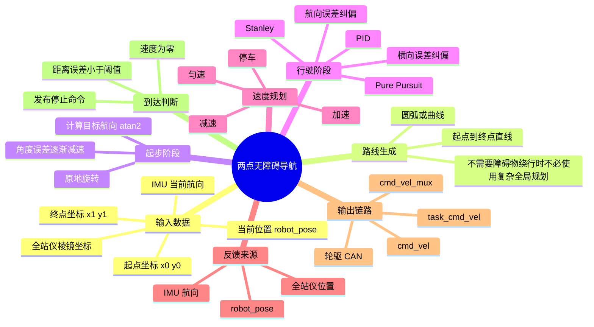
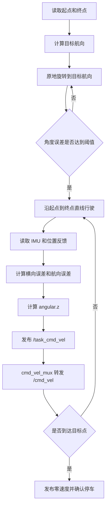
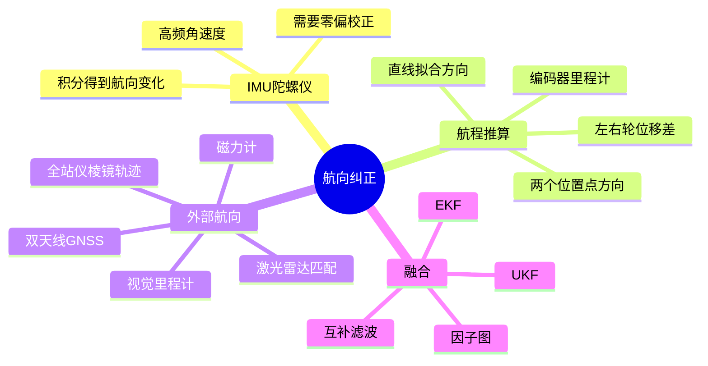
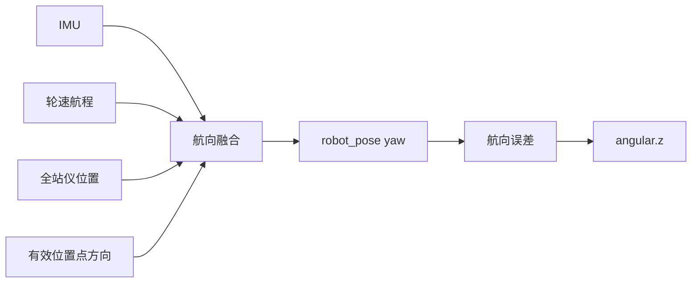

### 两点无障碍导航算法思维导图与对照表

本文把前面关于“小车如何改变角速度”和“小车在无障碍两点之间如何导航”的内容合并整理。

### 一、先看整体思路



### 二、两点导航的标准执行顺序



### 三、主要算法对照表

| 算法 | 主要输入 | 主要输出 | 适合场景 | 优点 | 注意事项 |
|---|---|---|---|---|---|
| 先转向再直行 | 起点、终点、当前航向 | 原地旋转角速度、直行速度 | 简单两点移动 | 最容易实现和调试 | 直行阶段仍需轻微纠偏，否则会走歪 |
| 航向误差控制 | 目标航向、当前 IMU 航向 | `angular.z` | 直线起步和轻微偏航 | 简单、响应快 | 不能单独修正横向位置偏差 |
| 横向误差 PID | 到目标直线的横向距离 | `angular.z` | 长直线跟踪 | 能把车辆拉回目标线 | 增益过大会左右摆动 |
| Stanley | 航向误差、横向误差、线速度 | `angular.z` | 直线跟随 | 同时修正车头和横向偏差 | 低速时要使用 `v0` 防止转向过强 |
| Pure Pursuit / RPP | 当前位姿、前瞻点、路径曲率 | `angular.z` | 曲线、圆形、连续路径 | 轨迹平滑，适合复杂路径 | 前瞻距离需要调节 |
| PID 位置导航 | 目标点位置误差、航向误差 | `linear.x`、`angular.z` | 短距离点到点 | 结构简单 | 需要处理角度归一化和积分饱和 |
| 梯形速度规划 | 距离、最大速度、加速度 | `linear.x` | 长距离直线 | 启停平滑，终点更容易停准 | 短距离可能没有匀速段 |
| 速度前馈加反馈 | 理论速度、实际位置和航向误差 | `angular.z` | 圆形和曲线 | 理论轨迹与误差修正结合 | 必须保证半径和速度参数准确 |
| A* / Dijkstra | 栅格地图、起点、终点 | 多段路径 | 有障碍物环境 | 能绕开障碍物 | 无障碍时通常没有必要 |
| RRT / RRT* | 起点、终点、障碍物地图 | 连续可行路径 | 复杂空间环境 | 能处理复杂障碍 | 结果可能需要平滑处理 |

### 四、庆哥原项目中的对应关系

| 原项目文件 | 作用 | 与角速度的关系 |
|---|---|---|
| `xline_follow_controller/config/line.yaml` | 直线跟随参数 | 设置对齐、跟随、原地旋转角速度参数 |
| `xline_follow_controller/config/rpp_circle.yaml` | 圆形路径参数 | 设置圆形线速度、角速度和滤波参数 |
| `xline_follow_controller/config/rpp_curve.yaml` | 曲线路径参数 | 设置曲线速度和角速度边界 |
| `xline_follow_controller/src/rpp_follow/rpp_follow_controller.cpp` | RPP 控制计算 | 根据曲率、航向误差和前瞻点生成 `angular.z` |
| `xline_base_controller/src/motion_control_center.cpp` | 控制中心 | 接收跟随控制器结果并发布 `/task_cmd_vel` |
| `xline_cmd_vel_mux/xline_cmd_vel_mux/cmd_vel_mux.py` | 速度仲裁 | 接收任务和网页速度，输出 `/cmd_vel` |
| `wheels_driver/wheels_driver/run_motor.py` | 轮速换算 | 用角速度和轮距计算左右轮速度 |

### 五、角速度是怎样产生的

#### 直线跟随

```text
目标直线方向 - 当前 IMU 航向 = 航向误差
小车到目标直线的垂直距离 = 横向误差
航向误差 + 横向误差
                ↓
         计算 angular.z
```

一种常见组合公式是：

```text
angular.z = K_yaw × 航向误差
          + K_cross × 横向误差
```

#### 圆形跟随

```text
理论角速度 = 线速度 / 圆半径
实际角速度 = 理论角速度 + 误差修正量
```

即：

```text
angular.z = v / r
          + K_yaw × 航向误差
          + K_radius × 半径误差
```

#### 原地转角

```text
角度误差 = 目标角度 - 当前角度
angular.z = 根据角度误差计算
角度误差变小 → 角速度降低
角度误差达到阈值 → angular.z = 0
```

### 六、各阶段推荐算法

| 阶段 | 推荐算法 | 原因 |
|---|---|---|
| 起点对准直线 | 原地旋转闭环 | 先消除初始航向误差 |
| 直线中段 | Stanley 或航向误差 + 横向误差 | 能纠正走歪问题 |
| 圆形路径 | RPP + `v/r` 前馈 | 保持圆周角速度关系 |
| 正方形转角 | 原地旋转闭环 | 目标角度明确，容易验证 90° |
| 接近终点 | 距离误差减速 | 减少冲过终点 |
| 到达终点 | 零速确认 | 防止旧速度继续输出 |

### 七、推荐给当前小车的组合

```mermaid
flowchart LR
    A[全站仪或 robot_pose] --> B[当前位置]
    C[IMU] --> D[当前航向]
    E[目标点] --> F[目标直线和目标航向]
    B --> G[横向误差]
    D --> H[航向误差]
    F --> G
    F --> H
    G --> I[Stanley或横向PID]
    H --> J[航向比例控制]
    I --> K[角速度合成]
    J --> K
    K --> L[角速度限幅与平滑]
    L --> M[/task_cmd_vel]
    M --> N[唯一cmd_vel_mux]
    N --> O[/cmd_vel]
```

推荐公式：

```text
直线：
angular.z = K_yaw × 航向误差
          + K_cross × 横向误差

圆形：
angular.z = v / r
          + 航向误差修正
          + 半径误差修正

转角：
angular.z = sign(角度误差) × 角度误差比例控制
```

### 八、算法选择结论

| 需求 | 最适合的算法 |
|---|---|
| 两点之间直接走过去 | 先转向再直行 |
| 直线划线不走歪 | Stanley + 航向误差控制 |
| 画圆 | RPP + `v/r` 角速度前馈 |
| 画正方形 | 直线跟踪 + 原地 90° 闭环旋转 |
| 途中存在障碍物 | A*、Dijkstra 或 RRT 生成路径，再交给 RPP/Stanley 跟踪 |
| 只做简单低速测试 | 位置 PID 或先转向再直行 |

当前 CAD 划线最建议的结构是：

```text
起点对准
→ 直线 Stanley/横向误差纠偏
→ 全站仪位置反馈
→ IMU 航向补偿
→ 终点减速
→ 零速确认
→ 原地旋转到下一条边
```

### 九、IMU、航程和其他航向纠正方法



IMU 航向由陀螺仪角速度积分得到，实际使用时先减去陀螺仪零偏。它更新快，适合原地旋转和全站仪短暂丢点，但长时间会产生积分漂移。

航程纠正有两种常见方式：一是用左右轮位移差除以轮距推算航向变化；二是用连续位置点的 `atan2(dy, dx)` 得到运动方向。第二种方法只有在位移超过最小有效距离时才更新，适合直线行驶，不适合原地旋转。

| 方法 | 适合阶段 | 优点 | 主要限制 |
|---|---|---|---|
| IMU陀螺仪 | 原地旋转、短时转向 | 高频、连续 | 长时间漂移 |
| 左右轮航程差 | 连续行驶 | 计算简单 | 打滑和轮距误差会累积 |
| 两个位置点方向 | 直线运动 | 可校正长期航向 | 静止时无方向，位置噪声会抖动 |
| 全站仪轨迹方向 | 空旷场地精密划线 | 位置和方向精度高 | 棱镜遮挡或数据超时 |
| 双天线GNSS | 室外大范围 | 直接得到车体方向 | 室内和遮挡环境不可用 |
| 视觉里程计 | 有纹理地面 | 可同时估计运动方向 | 受光照和纹理影响 |
| 激光雷达匹配 | 有固定环境结构 | 可和地图结合 | 空旷区域特征不足 |
| 磁力计 | 粗略定向 | 成本低 | 金属车体和电机干扰明显 |
| EKF/UKF/互补滤波 | 多传感器系统 | 可按可信度融合 | 需要时间戳、噪声参数和失效判断 |

### 十、航向融合和控制使用



| 运动阶段 | 首选来源 | 辅助来源 |
|---|---|---|
| 原地旋转 | IMU角速度积分 | 目标角度闭环 |
| 直线中段 | 全站仪位置点拟合方向 | IMU、轮速航程 |
| 圆形路径 | 切线方向和 `v/r` | IMU、全站仪半径误差 |
| 全站仪暂时失效 | IMU加轮速 | 最近一次有效航向，不能使用过期坐标 |

当前 CAD 划线建议采用：原地旋转使用 IMU，直线行驶使用全站仪位置方向校正 IMU，轮速提供短时连续估计，最后由 EKF 或互补滤波生成 `robot_pose yaw`，再根据航向误差和横向误差生成 `angular.z`。

