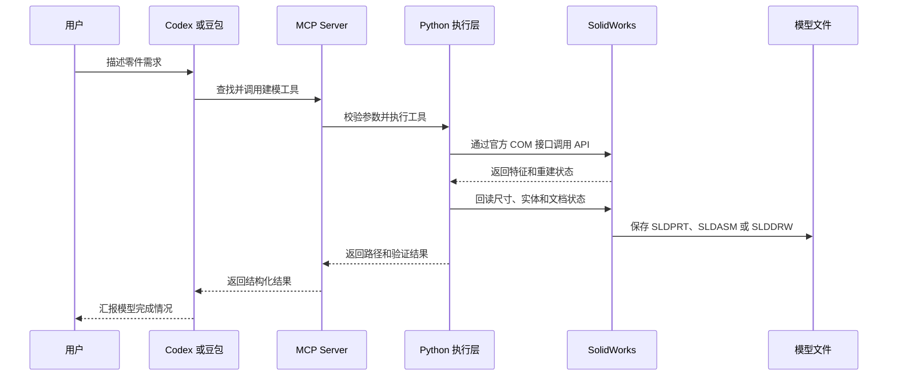

### SolidWorks MCP 建模描述模板

项目地址：

- [solidworks-automation-skill](https://github.com/wzyn20051216/solidworks-automation-skill)
- [codex_to_solidworks](https://github.com/jianjwu/codex_to_solidworks)

MCP 安装目录：`C:\aaa_software\aaa_program-self\SolidWorksMCP`

### 最推荐的固定开头

以后让 Codex 或豆包通过 MCP 调用 SolidWorks 时，优先使用下面的固定开头：

```text
通过 SolidWorks MCP 执行以下建模任务。
先检查连接和实际版本。
新建独立文档，不修改当前打开的文档。
使用 SolidWorks 原生、可编辑特征完成建模。
完成后重建、保存、回读关键尺寸，并返回文件路径和验证结果。
然后按照下面的模型要求执行：
```

### 通用模型描述模板

```text
通过 SolidWorks MCP 执行以下建模任务。
先检查连接和实际版本。
新建独立文档，不修改当前打开的文档。
使用 SolidWorks 原生、可编辑特征完成建模。
完成后重建、保存、回读关键尺寸，并返回文件路径和验证结果。
然后按照下面的模型要求执行：

模型类型：零件 / 装配体 / 工程图
模型名称：
单位：mm
材料：默认 / 指定材料
几何形状：
关键尺寸：
- 长度：
- 宽度：
- 高度或厚度：
- 直径：
- 半径：
- 角度：
- 孔数量和孔距：
建模顺序：
1. 
2. 
3. 
保存路径：使用绝对路径
输出格式：SLDPRT / SLDASM / SLDDRW / STEP / PDF
验证要求：
- 重建模型并检查错误和警告
- 回读关键尺寸
- 检查实体和特征树
- 确认文件真实存在
- 返回文件路径和验证结果
覆盖策略：不覆盖已有文件，使用新文件名
```

### 圆柱示例

```text
通过 SolidWorks MCP 执行以下建模任务。
先检查连接和实际版本。
新建独立文档，不修改当前打开的文档。
使用 SolidWorks 原生、可编辑特征完成建模。
完成后重建、保存、回读关键尺寸，并返回文件路径和验证结果。
然后按照下面的模型要求执行：

创建一个圆柱零件：
- 直径：50 mm
- 厚度：20 mm
- 单位：mm
- 使用草图和拉伸特征完成
- 保存为新的 SLDPRT 文件
- 保存路径：`C:\aaa_software\aaa_program-self\SolidWorksMCP\output\cylinder_d50_h20.SLDPRT`

验证：
- 回读直径和厚度
- 检查重建错误和警告
- 确认文件真实存在
- 返回文件路径、文件大小和验证结果
```

### 实际执行原理

Codex 或豆包负责理解建模需求并调用 MCP 工具。MCP Server 将结构化参数交给 Python 执行层，Python 通过 `pywin32` 调用 SolidWorks 官方 COM 接口，SolidWorks 再创建草图、拉伸、孔、圆角等原生可编辑特征，最后保存并回读模型结果。



### 描述模型时必须写清楚

| 内容 | 示例 |
|---|---|
| 操作对象 | 新建零件、装配体或工程图 |
| 文档保护 | 不修改当前打开的文档 |
| 几何形状 | 圆柱、齿轮、支架、法兰 |
| 关键尺寸 | 长度、厚度、直径、孔距、角度 |
| 单位 | mm、degree |
| 建模方式 | 原生草图、拉伸、旋转、孔、圆角 |
| 保存路径 | 绝对路径 |
| 输出格式 | SLDPRT、SLDASM、SLDDRW、STEP、PDF |
| 验证要求 | 重建、回读尺寸、检查错误和文件存在性 |
| 覆盖策略 | 不覆盖已有文件，使用新文件名 |

### 一句话版本

```text
通过 SolidWorks MCP 检查连接和实际版本，新建独立文档，不修改当前打开的文档，使用 SolidWorks 原生可编辑特征按以下尺寸建模，完成后重建、保存、回读关键尺寸，并返回文件路径和验证结果：这里填写具体模型、尺寸、单位、建模顺序和保存路径。
```
