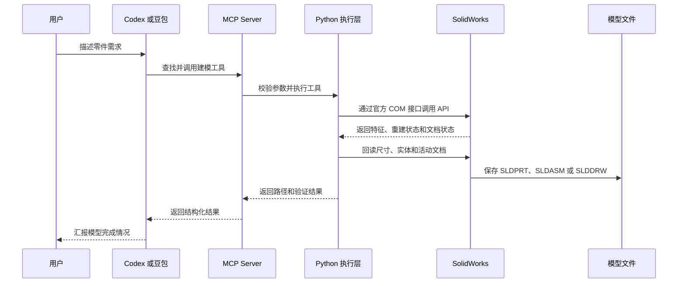

SolidWorks学习笔记
[【全748集】目前B站最全最细的solidworks零基础全套教程，2025最新版，包含所有干货！七天就能从小白到大神！少走99%的弯路！存下吧！很难找全的！\_哔哩哔哩\_bilibili](https://www.bilibili.com/video/BV1gYjEzhEZ4/?spm_id_from=333.1387.favlist.content.click&vd_source=ea35c10f59aa46851935d37df4345603)


![[Pasted image 20261031181837.png]]


### 界面介绍
![[Pasted image 20261031192746.png]]
![[Pasted image 20261031192013.png]]

![[Pasted image 20261031200045.png]]

| 模式      | 核心含义                              | 适用场景                        | 加载速度 | 能不能编辑零件                |
| ------- | --------------------------------- | --------------------------- | ---- | ---------------------- |
| 还原      | 把所有零件的完整信息（草图、特征、装配关系）全部加载进内存     | 要改零件、做最终干涉检查、导出工程图的时候用，最稳   | 最慢   | 完全可编辑                  |
| 轻化      | 只加载零件的外壳显示信息，内部细节等需要时再临时读入        | 日常打开几十个零件的机架装配用，平衡速度和功能，最常用 | 中等   | 可以编辑，第一次改零件时会自动补加载完整信息 |
| 大型装配体模式 | 自动开优化：默认**轻化零件、隐藏多余基准面/草图**、关实时预览 | 上百个零件的机器人总装、打开卡顿的时候选这个      | 快    | 可编辑，只是临时隐藏了辅助元素        |
| 大型设计审阅  | 只加载零件外形轮廓，不读特征树，极速打开              | 只是快速看一眼别人发的总装、不修改、只查结构的时候用  | 最快   | 不能直接编辑，只能测量、切剖面看       |

![[Pasted image 20261023235618.png]]

选项卡后面可以用到的工具

![[Pasted image 20261024001053.png]]


#### 任务栏窗格
各个部件的颜色及性质

![[Pasted image 20261031235415.png]]


自定义属性

![[Pasted image 20261101000816.png]]

视图对应的按键就是这个
![[Pasted image 20261101001253.png]]


窗口设置平铺或者什么的就能看见多个零件

Ctrl+tab就能切换视图窗口
多窗口
![[Pasted image 20261106214602.png]]
![[Pasted image 20261106214638.png]]


[00:03:34.721](jv://?url=https://www.bilibili.com/video/BV1gYjEzhEZ4/?spm_id_from=333.788.player.switchyu26vd_source=ea35c10f59aa46851935d37df4345603yu26p=5&time=00:03:34.721)
![[Pasted image 20261101001612.png]]

生成工程图
![[Pasted image 20261105185105.png]]

![[Pasted image 20261105185222.png]]

自动调取所有的零件，因为有时候导入的零件是散着在各种盘的，还可以加上工程图

前缀上加入一个名字做一个区分
![[Pasted image 20261105185638.png]]

### Codex 或豆包通过 SolidWorks MCP 生成模型

#### 最推荐的固定开头

以后让 Codex 或豆包通过 MCP 生成 SolidWorks 模型时，固定使用下面这段开头：

```text
通过 SolidWorks MCP 执行以下建模任务。
先检查连接和实际版本。
新建独立文档，不修改当前打开的文档。
使用 SolidWorks 原生、可编辑特征完成建模。
完成后重建、保存、回读关键尺寸，并返回文件路径和验证结果。
然后按照下面的模型要求执行：
```

这段固定开头解决了几个常见问题：

| 固定要求 | 作用 |
|---|---|
| 通过 SolidWorks MCP | 明确使用 MCP 工具链，不让 Agent 只写一段未执行的 Python 代码 |
| 先检查连接和实际版本 | 确认 SolidWorks 正在运行，并识别实际 API 版本 |
| 新建独立文档 | 防止误修改当前打开的零件或装配体 |
| 原生、可编辑特征 | 要求生成草图、拉伸、孔、圆角等特征树，而不是只生成图片或网格 |
| 重建、保存、回读 | 验证模型确实生成，尺寸也确实符合要求 |
| 返回文件路径和验证结果 | 方便找到产物，也能区分“工具调用成功”和“模型真的完成” |

#### 通用建模描述模板

将固定开头后面的内容替换成具体需求：

```text
通过 SolidWorks MCP 执行以下建模任务。
先检查连接和实际版本。
新建独立文档，不修改当前打开的文档。
使用 SolidWorks 原生、可编辑特征完成建模。
完成后重建、保存、回读关键尺寸，并返回文件路径和验证结果。
然后按照下面的模型要求执行：

模型类型：零件 / 装配体 / 工程图
模型名称：
单位：mm
材料：默认 / 指定材料
几何形状：
关键尺寸：
- 长度：
- 宽度：
- 高度或厚度：
- 直径：
- 半径：
- 角度：
- 孔数量和孔距：
建模顺序：
1. 
2. 
3. 
保存路径：
输出格式：SLDPRT / SLDASM / SLDDRW / STEP / PDF
验证要求：
- 回读哪些尺寸：
- 检查哪些特征：
- 是否导出预览：是 / 否
- 是否覆盖已有文件：否，必须使用新文件名
```

#### 圆柱示例

```text
通过 SolidWorks MCP 执行以下建模任务。
先检查连接和实际版本。
新建独立文档，不修改当前打开的文档。
使用 SolidWorks 原生、可编辑特征完成建模。
完成后重建、保存、回读关键尺寸，并返回文件路径和验证结果。
然后按照下面的模型要求执行：

创建一个圆柱零件：
- 直径：50 mm
- 厚度：20 mm
- 单位：mm
- 保存为新的 SLDPRT 文件
- 保存路径：
  C:\aaa_software\aaa_program-self\SolidWorksMCP\output\cylinder_d50_h20.SLDPRT

验证：
- 回读圆柱直径和厚度
- 检查重建错误和警告
- 确认文件真实存在
- 返回文件路径、文件大小和验证结果
```

#### 齿轮示例

```text
通过 SolidWorks MCP 执行以下建模任务。
先检查连接和实际版本。
新建独立文档，不修改当前打开的文档。
使用 SolidWorks 原生、可编辑特征完成建模。
完成后重建、保存、回读关键尺寸，并返回文件路径和验证结果。
然后按照下面的模型要求执行：

创建一个标准渐开线直齿轮：
- 模数：2 mm
- 齿数：20
- 压力角：20 degree
- 齿宽：10 mm
- 单位：mm
- 保存路径：
  C:\aaa_software\aaa_program-self\SolidWorksMCP\output\gear_m2_z20.SLDPRT

建模要求：
1. 根据模数、齿数和压力角计算渐开线齿廓。
2. 创建闭合的 SolidWorks 草图轮廓。
3. 使用原生拉伸特征生成实体。
4. 重建后检查是否存在错误。
5. 回读齿数、外径和齿宽。
6. 返回 SLDPRT 路径和验证结果。
```

#### SolidWorks MCP 的实际执行原理

Codex 或豆包负责理解需求并选择 MCP 工具，SolidWorks MCP Server 负责把工具调用转交给 Python，Python 再通过 SolidWorks 官方 COM 接口连接本机 SolidWorks。真正创建草图、特征和实体的是 SolidWorks API。



#### 你电脑上的实际链路

| 层级 | 当前实现 |
|---|---|
| Agent | Codex 或支持 MCP 的豆包客户端 |
| MCP Server | `C:\aaa_software\aaa_program-self\SolidWorksMCP\mcp-server\server.py` |
| Python | `C:\aaa_software\aaa_program-self\SolidWorksMCP\.venv\Scripts\python.exe` |
| COM 库 | `pywin32`、`comtypes`、SolidWorks 类型库 |
| CAD 软件 | SolidWorks 2025 |
| 输出目录 | `C:\aaa_software\aaa_program-self\SolidWorksMCP\output` |

#### 描述模型时必须写清楚

| 内容 | 示例 |
|---|---|
| 操作对象 | 新建零件、修改零件、创建装配体 |
| 文档保护 | 不修改当前打开的文档 |
| 几何形状 | 圆柱、齿轮、支架、法兰 |
| 关键尺寸 | 长度、厚度、直径、孔距、角度 |
| 单位 | mm、degree |
| 建模方式 | 原生草图、拉伸、旋转、孔、圆角、装配配合 |
| 保存路径 | 使用绝对路径 |
| 输出格式 | SLDPRT、SLDASM、SLDDRW、STEP、PDF |
| 验证要求 | 重建、回读尺寸、检查错误和文件存在性 |
| 覆盖策略 | 不覆盖已有文件，使用新文件名 |

#### 不推荐的简略说法

```text
帮我画一个支架。
```

这句话缺少尺寸、单位、特征顺序、保存位置和验证要求。推荐改成：

```text
通过 SolidWorks MCP 执行以下建模任务。
先检查连接和实际版本。
新建独立文档，不修改当前打开的文档。
使用 SolidWorks 原生、可编辑特征完成建模。
完成后重建、保存、回读关键尺寸，并返回文件路径和验证结果。
然后创建一个支架零件：
- 底板：100 × 60 × 8 mm
- 两侧立板：厚度 8 mm，高度 50 mm
- 两侧立板间距：40 mm
- 顶部通孔：直径 20 mm
- 单位：mm
- 保存为新的 SLDPRT 文件
- 不覆盖已有文件
- 返回主要尺寸和验证结果
```

### 1. 制作草图


[00:04:33.281](jv://?url=https://www.bilibili.com/video/BV1wx5y6NEDv/?spm_id_from=333.788.player.switchyu26vd_source=ea35c10f59aa46851935d37df4345603yu26p=2&time=00:04:33.281)
![[Pasted image 20261024001345.png]]
前视图xy面
上视图xz面
右视图zy面

![[Pasted image 20261024001634.png]]

#### 智能尺寸
智能尺寸，能给线段定尺寸，放手的位置就是数字最终落点的位置。
![[Pasted image 20261024180600.png]]

2. 拖动测量两条线之间的距离，分别点击两条线，然后拖动出来给出一个距离。
![[Pasted image 20261028233355.png]]

3. 点击两条线然后推动出一个角度，可以给出两条线之间的角度
![[Pasted image 20261028233614.png]]

4.可以点击一个点到一条线的距离设置为多少，
![[Pasted image 20261028234632.png]]

构造线，虚线
![[Pasted image 20261024224509.png]]

![[Pasted image 20261024224853.png]]
中点线打端点和中点

矩形，边角矩形，中点矩形（对称图形），三点矩形

槽口命令

镜像实体
[00:32:32.280](jv://?url=https://www.bilibili.com/video/BV1wx5y6NEDv/?spm_id_from=333.1391.0.0yu26p=2yu26vd_source=ea35c10f59aa46851935d37df4345603&time=00:32:32.280)
![[Pasted image 20261024235545.png]]

线性草图阵列
![[Pasted image 20261025003050.png]]

### 2. 尺寸约束和几何约束

几何约束：
1. 水平
2. 竖直
3. 重合

给定好智能尺寸之后，长宽高无法改变
![[Pasted image 20261025004735.png]]

变成**黑色的线**将线给固定住，绿色的东西就是约束，把绿色的删除就没有约束了，

最左边的就是端点约束，中间绿色的就是水平约束，让线水平。
![[Pasted image 20261025010734.png]]


给一个倾斜角就能固定住线，让线没有办法移动
![[Pasted image 20261025011255.png]]
![[Pasted image 20261025011413.png]]


多条线之间的约束
[00:07:45.549](jv://?url=https://www.bilibili.com/video/BV1wx5y6NEDv/?spm_id_from=333.1391.0.0yu26p=3yu26vd_source=ea35c10f59aa46851935d37df4345603&time=00:07:45.549)
![[Pasted image 20261028230909.png]]


### 考试一
![[Pasted image 20261028232953.png]]

给出一个相对关系，让两条线保证一个中心对称，让两条线能够中心对称
![[Pasted image 20261028233810.png]]

![[Pasted image 20261029000219.png]]

#### 练习题2
![[Pasted image 20261030232840.png]]
左上角视图 = 前视（正视图）
右上角视图 = 右视（侧视图）
左下角视图 = 上视（俯视图，从上面往下看）
![[Pasted image 20261030233339.png]]
![[Pasted image 20261030233148.png]]
![[Pasted image 20261030233408.png]]

中间的矩形可以用中间矩形绘制出来
可以选中面然后进行拉伸
![[Pasted image 20261031003532.png]]


#### 练习2
![[Pasted image 20261031173617.png]]


## 曲线设计

![[Pasted image 20261031003634.png]]
### 注意事项

最重要的通过几何约束和尺寸约束进行调节
圆弧一般通过裁剪，画而不是直接画出来

1. 最终的图都要是有约束的，都要是黑色的不能有一点蓝色的。

# 快捷键

|     |       |
| --- | ----- |
| 空格  | 视图的方位 |

| 平移图纸位置 |     |
| ------ | --- |
|        |     |

长按S键，就会有，快捷方式栏
![[Pasted image 20261031233501.png]]
![[Pasted image 20261031233524.png]]


### 图标解析

![[Pasted image 20261031234150.png]]
# 装软件之后必须要的操作，


1. 默认模版

![[Pasted image 20261024000712.png]]

1. 开启几何约束

![[Pasted image 20261025004951.png]]


## 问题

1. 拖动颜色或者材质，无法改变实体的颜色和材质
![[Pasted image 20261101000014.png]]
